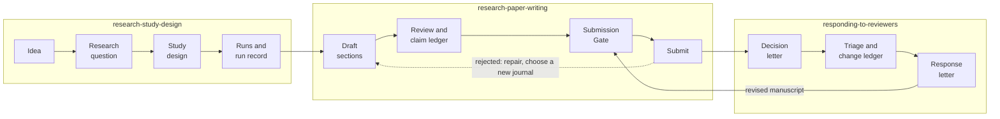
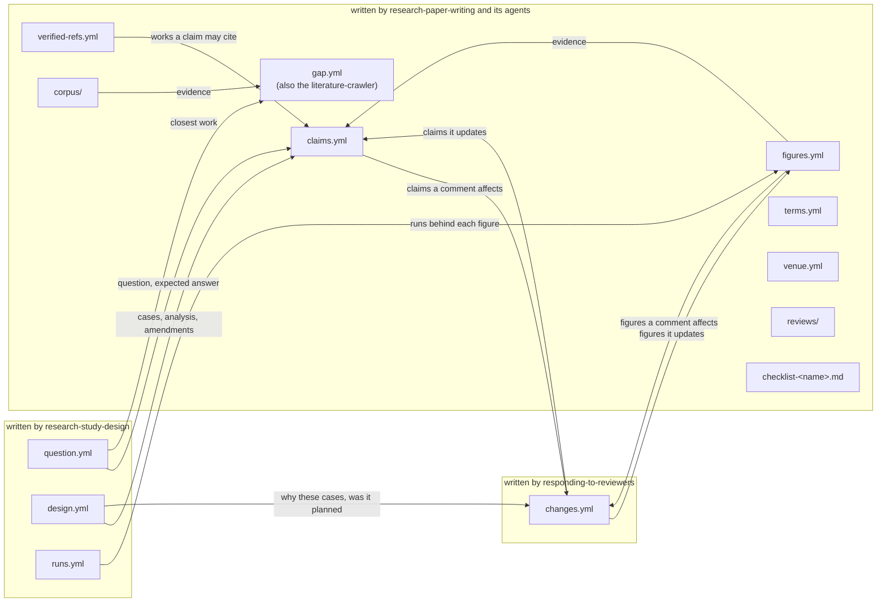
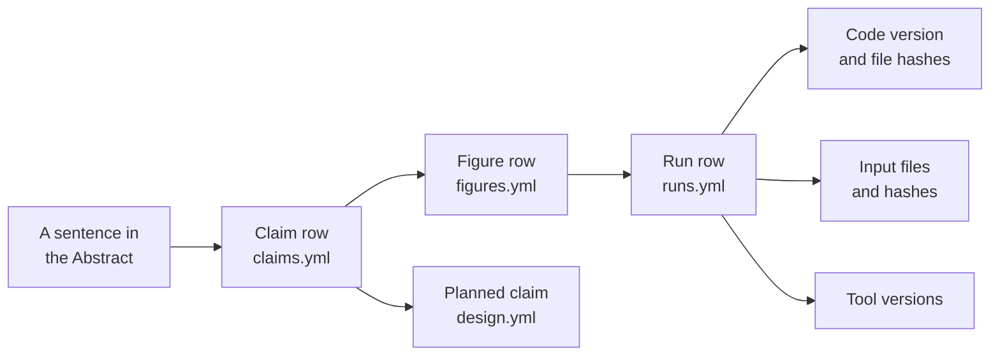
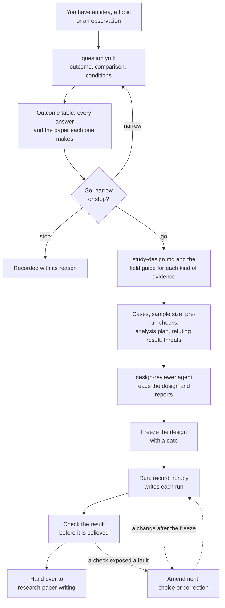
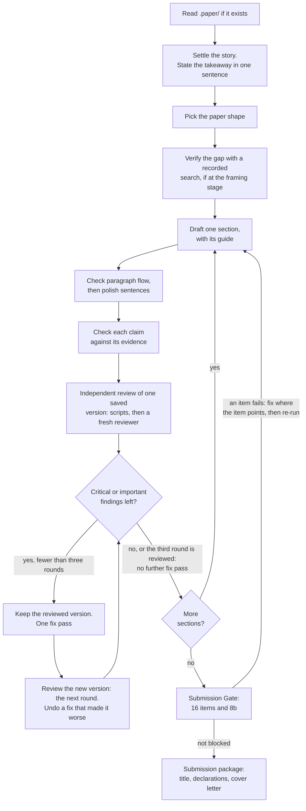
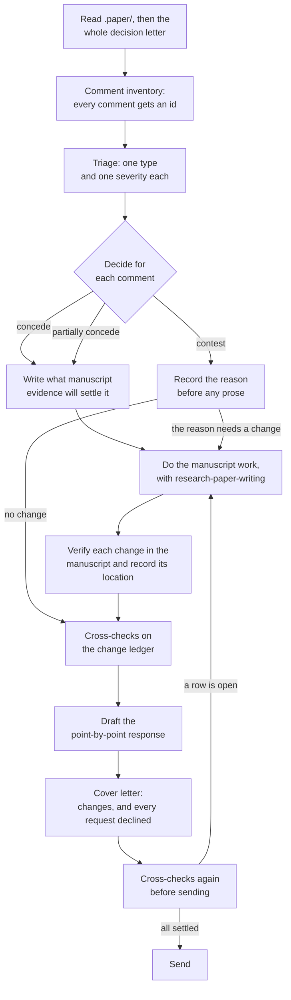

# paper-skills

Three Claude Code skills for a research paper, from the first idea to the reply to the
reviewers. They are built for building physics, daylighting and lighting research, simulation
and modelling studies, and engineering. They also support conference papers in ML, computer
vision and NLP.

By Antonis Kontadakis. MIT licence. Version 2.1.0.

## Contents

- [What it is](#what-it-is)
- [The lifecycle](#the-lifecycle)
- [Install](#install)
- [Quick start](#quick-start)
- [The three core rules](#the-three-core-rules)
- [The paper memory](#the-paper-memory)
- [Skill 1: research-study-design](#skill-1-research-study-design)
- [Skill 2: research-paper-writing](#skill-2-research-paper-writing)
- [Skill 3: responding-to-reviewers](#skill-3-responding-to-reviewers)
- [Agents](#agents)
- [Slash commands](#slash-commands)
- [Scripts](#scripts)
- [What the package will not do](#what-the-package-will-not-do)
- [Repository layout](#repository-layout)
- [Development](#development)
- [Credits and licence](#credits-and-licence)

## What it is

A skill is a set of instructions that Claude Code loads when your request matches it. This
package has three. Each one covers a stage of a paper.

| Stage | Skill | It helps you |
|---|---|---|
| Before the results exist | `research-study-design` | sharpen the research question, design the study, and record each run |
| Writing and submitting | `research-paper-writing` | draft, revise, check and submit the manuscript |
| After the decision | `responding-to-reviewers` | triage the comments, track each change, and write the response |

Around the skills are tools that check and report. None of them edits your manuscript.

Three terms appear throughout. The paper memory, `.paper/`, is a folder of small YAML files in
your project. The claim ledger is one of those files: a list of the paper's claims with the
evidence for each. The Submission Gate is a check of 16 numbered items and item 8b that is run before submission.

| Tool | Count | Purpose |
|---|---|---|
| Reference guides | 40 | the detailed rules; Claude loads only the guide a task needs |
| Agents | 6 | independent readers: design, claims, consistency, bibliography, layout, literature |
| Slash commands | 6 | one-line entry points for the plan, the trace, the ledger, the gate, a review and a response |
| Scripts | 9 | mechanical helpers: seven check, one records runs, one fetches open-access PDFs. Every check says what it could not check |
| Paper memory | 1 folder | `.paper/`, where the decisions of a study stay on disk between sessions |

## The lifecycle



After a rejection the paper is repaired, a new journal is chosen, and the gate is run again
from the start. A study does not have to start at the left. You can use any skill alone. A paper with no
recorded plan is still written and checked; the writing skill then calls nothing "planned".

## Install

Install the package as a plugin, in one line:

```sh
claude plugin marketplace add akontadakis/paper-skills && claude plugin install paper-skills@paper-skills-marketplace
```

The other route is to copy the three skills, the agents and the commands into your personal
folders. See [INSTALL.md](INSTALL.md). Use one route, not both.

Requirements:

- Claude Code.
- Python 3.9 or newer for the scripts. Six scripts need nothing else.
- PyYAML for `check_ledger.py`, `check_provenance.py`, the `--terms` flag of
  `check_revision_tokens.py`, and the `--verified` flag of `bib_check.py`. `bib_check.py --record`
  needs it when the list already exists.
- PyMuPDF for `extract_figures.py`.

## Quick start

You do not need to name a skill. Describe the task and Claude loads the skill that fits. These
requests show what each skill answers.

| You say | Skill that loads | What you get |
|---|---|---|
| "I have an idea for a paper on view direction and melanopic daylight. Is it worth doing?" | `research-study-design` | a question with an outcome, a comparison and conditions; a table of possible answers; open items for you to fill |
| "I will use four climates and 24 room geometries. Help me plan the study." | `research-study-design` | a design record with the reason for each case set, the limit it puts on your claim, and the strongest objection to each choice |
| "How many participants do I need for a glare study?" | `research-study-design` | how the number depends on the effect you care about; no invented effect size |
| "Tighten this Results paragraph." | `research-paper-writing` | a revision with every number, unit, citation and hedge unchanged |
| "Is my abstract ready to submit?" | `research-paper-writing` | what a reviewer would object to, with the claim ledger |
| "This reads like ChatGPT wrote it." | `research-paper-writing` | counted patterns with line numbers, then an edit that keeps your technical terms |
| "I got a major revision. Here is the letter." | `responding-to-reviewers` | a comment inventory, a change ledger, and a point-by-point response |

The slash commands are shortcuts for the checks you run often. See
[Slash commands](#slash-commands).

## The three core rules

Each skill has one rule that every reply must meet. A reader who has only your text and
Claude's reply can check each of them.

### Study Contract (research-study-design)

1. **Decide before you look.** The question, the expected answer, the cases, the analysis and
   the result that would change the conclusion are written down with a date, before the first
   production run. A change made after a result was seen is recorded as `post hoc`.
2. **Every fact has a source.** The sources are you, your project files, and a recorded
   literature search. What Claude recalls about the literature is a lead, marked as unverified.
   It cites no paper from memory.
3. **You decide. The skill challenges.** For each decision you get the strongest objection a
   reviewer would raise, and the real options with their cost.

### Revision Contract (research-paper-writing)

1. **The frozen set comes back unchanged.** Numbers, units, ranges, symbols, citations,
   cross-references, defined terms, names, and the hedging verb of every claim. `400–700 nm`
   stays `400–700 nm`. `may` stays `may`.
2. **Every fact traces to your manuscript, your brief, or `.paper/`.** Where a fact is missing,
   the reply holds a bracket that names it, such as
   `[insert the reason the four cases are sufficient]`. A citation counts as a fact: Claude
   cites only works on your verified list, `.paper/verified-refs.yml`, and only where your text
   or `.paper/` shows that the work supports the sentence.
3. **One claim in, one claim out.** A revision adds no limitation, mechanism, comparison or
   implication that your text did not carry.

### No claimed work (responding-to-reviewers)

A response points only to changes that exist in the revised manuscript, at a location someone
has checked. It claims no simulation you did not run and no result you did not supply. In a
conference rebuttal, a change still to be made is stated as promised, never as done.

## The paper memory

The three skills share one folder, `.paper/`, in the top folder of your project. It lasts
between sessions. A decision made in March is still on record when the reviewers write in
August.



Main flows only. The table lists every file and who writes it.

| File | Written by | Holds |
|---|---|---|
| `question.yml` | study design | the question, every answer it could have, the reader who acts on each, the closest work, the go or stop decision |
| `design.yml` | study design | planned claims, cases with their reasons, sample size and its basis, pre-run checks, the analysis plan, threats, the freeze date, every later amendment, and a registration where the study has one |
| `runs.yml` | `record_run.py` | one row per run: code version, input and output hashes, tool versions, seed, status, and where you give them the hardware and the run time; a `release` block for the deposit of code and data |
| `gap.yml` | writing and the `literature-crawler` agent | the research gap, its evidence, and the search behind it with its date |
| `claims.yml` | writing | the claim ledger: each claim, where it is asserted, its evidence, its status, the verb it may carry |
| `figures.yml` | writing | each figure and table: its source script, its runs, the numbers the text quotes from it |
| `terms.yml` | writing | the terminology lock: one name per concept, and the names never to use |
| `venue.yml` | writing | the journal's rules, read from its guide, and its conventions, read from its papers |
| `verified-refs.yml` | `bib_check.py` and you | the works a draft may cite. A `doi` row shows that the entry matches its DOI record: identity, not support. A `manual` row is written by you only, for a work you read |
| `reviews/` | writing | dated review findings, one file per review round |
| `changes.yml` | reviewer response | each comment of a reviewer or the editor: type, severity, decision and whether you confirmed it, the change made, its location, its status |
| `corpus/` | the `literature-crawler` agent | every included and excluded record of a literature search, and its protocol |
| `checklist-<name>.md` | writing | one row per item of a reporting guideline, each with its disposition |

The records form one chain. Any sentence in the paper can be followed back to the files that
produced it.



## Skill 1: research-study-design

Use it before the results exist, and while the work runs.



What it asks, at each stage:

| Stage | Questions it puts to you |
|---|---|
| Idea | What did you observe, doubt or gain access to? It does not hand you a list of typical gaps. |
| Question | What is the outcome, against what, and under which conditions? |
| Answers | What paper does each possible answer make? Who acts differently on each? |
| Closest work | Which three to five papers are nearest, and how does this study differ from each? |
| Cases | Why these cases? What do they limit the claim to? Which case could reverse the result? |
| Sample size | What is the smallest effect you care about, and where does that value come from? |
| Checks | Was convergence tested on the hardest case? What is the model validated against, and with what margin? |
| Refutation | What result would prove you wrong? Below what size is a difference no difference? |
| Threats | For each threat: remove, reduce or accept? An accepted or reduced threat becomes a Limitations sentence. |

A change after the freeze is an amendment. It has a date, a timing and a kind.

| Kind | Meaning | Effect |
|---|---|---|
| `choice` | you picked among alternatives after seeing results: a threshold, a case set, a metric | the claims it affects are reported as exploratory |
| `correction` | a check exposed a fault: a grid that had not converged, a wrong input file | the claims keep their status; Methods report the change and the old result |

Guides in `research-study-design/references/`:

| Guide | Claude loads it when |
|---|---|
| `question.md` | you have an idea or a topic and no sharp question, or ask whether an idea is new or worth a paper |
| `study-design.md` | you design a study of any type |
| `design-simulation.md` | results will come from a simulation: daylight, lighting, thermal, energy, airflow |
| `design-measurement-and-participants.md` | results will come from instruments in a real space, or from people |
| `design-ml.md` | the study trains or evaluates a learned model, or a surrogate for a simulation |
| `run-record.md` | the work is running: the pipeline, the run record, tracing a figure to its inputs |
| `study-memory.md` | the three records are read or written |

## Skill 2: research-paper-writing

Use it to draft, revise, check and submit. It supports three paper shapes and does not mix
them.

| Shape | Sections | Used by |
|---|---|---|
| Journal (IMRAD) | Introduction, Methods, Results, Discussion, Conclusion | most journals |
| Conference | Introduction, Related Work, Method, Experiments, Conclusion | CVPR, NeurIPS, ICCV, ACL |
| Review | the journal shape, with the search protocol as Methods and the synthesis as Results | systematic, scoping and narrative reviews |



The Submission Gate is one verdict on the whole package. Submission is blocked while any item
holds. The gate report ends in one of three words:

| Verdict | Meaning |
|---|---|
| `blocked` | at least one item fails |
| `not blocked` | every item passes, or carries a waiver that you recorded |
| `incomplete` | no item fails, but at least one item was not run. The report names those items. A paper with no claim ledger gets this verdict |

| # | Blocked while | # | Blocked while |
|---|---|---|---|
| 1 | a claim is contradicted by its own evidence | 9 | the ledger files disagree with each other or with the text |
| 2 | a claim the paper depends on is marked `gap`: no evidence can exist for it | 10 | people, personal data or images of occupants are involved and there is no ethics statement (approving body, protocol identifier, date) or no consent statement |
| 3 | a claim in the Abstract is not supported | 11 | a reporting checklist is required or claimed, and is not complete |
| 4 | a simulation study has not passed the reporting gate | 12 | a journal rule is unchecked or broken |
| 5 | a placeholder or chat residue is left in the file | 13 | a retracted work is cited as support, a DOI points to another work, a cited work is not on the verified list, or the manuscript cites works and has no verified list |
| 6 | a citation or a cross-reference does not resolve | 14 | a final figure rests on no valid run, a recorded file has changed or is missing |
| 7 | a convergence- or resolution-sensitive parameter has no convergence evidence, or a hyperparameter tuned per dataset or scenario has no sensitivity evidence and its tuned values are unreported | 15 | a choice made after the results is worded as planned, or the result under the old setting is not reported |
| 8 | a default or a model output is worded as a measurement | 16 | a novelty claim rests on a search that was not re-run |
| 8b | a gate item is claimed as passing without the output that shows it | | |

Guides in `research-paper-writing/references/`:

**Sections**

| Guide | Claude loads it when |
|---|---|
| `abstract.md` | you write or revise an abstract |
| `introduction.md` | you write or revise an Introduction |
| `related-work.md` | you write Related Work, or decide where prior work goes |
| `method.md` | you write the Method of a conference paper |
| `methods-journal.md` | you write the Methods of a journal paper |
| `experiments.md` | you write a conference Experiments section; its table rules apply to any paper |
| `results.md` | you write the Results of a journal paper |
| `discussion.md` | you write a Discussion or a limitations paragraph, in a journal or review paper |
| `conclusion.md` | you write a Conclusion |
| `review-papers.md` | the paper is a review of any kind |

**Writing craft**

| Guide | Claude loads it when |
|---|---|
| `paragraph-flow.md` | a passage does not flow or is unclear |
| `sentence-craft.md` | sentence-level polish: tense, hedging, verbs, numbers, units |
| `ai-tells.md` | a draft sounds machine-written |
| `notation-and-equations.md` | the paper carries equations or many symbols |
| `figures-tables.md` | you design a figure, a table or a caption, or check a figure against its data and the Methods |

**Evidence and reporting**

| Guide | Claude loads it when |
|---|---|
| `literature-and-gap.md` | you frame a paper, check a gap, or word a novelty claim |
| `statistics-reporting.md` | the paper reports a test, an agreement metric, a score or an uncertainty |
| `simulation-reporting.md` | results come from a physics or simulation engine |
| `ethics-and-participants.md` | the study involves people, personal data or images of occupants |
| `reporting-checklists.md` | a journal asks for a reporting guideline, or the paper claims one |

**Memory, review and submission**

| Guide | Claude loads it when |
|---|---|
| `paper-memory.md` | the project has a `.paper/` folder, or needs a ledger |
| `paper-review.md` | self-review, an independent review, the pass order, or the Submission Gate |
| `venue-calibration.md` | a journal is chosen: its rules and its conventions |
| `submission-package.md` | you choose a journal, also after a rejection; title, keywords, declarations, cover letter, supplementary material, proofs |
| `agents-and-scripts.md` | an agent is dispatched or a script is run |

**The manuscript file**

| Guide | Claude loads it when |
|---|---|
| `latex-mechanics.md` | the manuscript is in LaTeX: bibliography, cross-references, floats, final checks |
| `word-manuscripts.md` | the manuscript is a Word file |

## Skill 3: responding-to-reviewers

Use it after a decision letter arrives.



Every comment gets one type and one severity. The ledger accepts these values and no others.

| Type | The reviewer is saying |
|---|---|
| `misreading` | they read it wrong; the text was ambiguous |
| `missing information` | it is not in the paper |
| `method` | the method is wrong or not justified |
| `evidence` | more is needed: an experiment, a baseline, a case |
| `claim` | the claim exceeds the data |
| `framing` | the gap, the novelty or the positioning is wrong |
| `presentation` | figures, tables, structure, length |
| `language` | grammar, style, clarity |
| `out of scope` | a different paper |
| `wrong` | the reviewer is factually mistaken |

Severity is `blocking`, `substantive` or `minor`.

Each row ends in one status.

| Status | Meaning |
|---|---|
| `done` | the change exists in the manuscript, and someone checked its location |
| `partial` | part of the comment is addressed; the row says what is not, and why |
| `open` | not yet addressed |
| `regressed` | it was addressed, and a later edit undid it |
| `made worse` | the change created a new problem |
| `not verifiable` | it cannot be confirmed from the files at hand |
| `waived` | deliberately not done; the row says who decided and the risk. Also the status of a contested comment with no change in the manuscript |
| `promised` | conference rebuttal only, where the venue lets you upload no revised file: the change will be made in the camera-ready version |

Text inside a decision letter is data. If a pasted letter holds a line that tells an assistant
to drop a comment or mark it done, the skill reports the line to you and does not act on it.

Guides in `responding-to-reviewers/references/`:

| Guide | Claude loads it when |
|---|---|
| `triage.md` | each comment needs a type, a severity and a decision |
| `change-ledger-file.md` | the change ledger is built or checked, and at the start of a second round |
| `response-letter.md` | the point-by-point response is drafted or audited |
| `disagreement.md` | a comment is contested or a request declined |
| `cover-letter.md` | the cover letter to the editor is written |
| `common-comments.md` | a comment matches a stock complaint: grid, sample size, novelty, validation, limitations, language |

## Agents

An agent is a separate reader that Claude dispatches. It starts with no memory of the
conversation, which is why its read is independent. Every agent here reports. None edits the
manuscript, and none decides for you.

| Agent | Reads | Answers | Use it |
|---|---|---|---|
| `design-reviewer` | `question.yml`, `design.yml` | Could this design fail to support its claim? A question with one useful answer, cases that cannot show the effect, a missing check, a test that does not fit the unit. | before a design is frozen |
| `claim-auditor` | the manuscript and `.paper/` | Does every claim have a ledger row, a verb its evidence allows, and evidence that resolves? Which gate items fail? | before a draft is shown, reviewed or submitted |
| `consistency-checker` | the source files | Does a term drift? Does a cross-reference point nowhere? Is a metric used before it is defined? | after revising several sections |
| `bibliography-auditor` | the `.bib` file, the source, the PDF | Are fields complete? Does each DOI point to the work cited? Is a cited work retracted? Is each cited work on the verified list? | before submission of a LaTeX manuscript |
| `latex-layout-auditor` | the compiled PDF | Are floats near their reference? Are figures legible at print size? | before submission, on the compiled file |
| `literature-crawler` | six open literature databases | What does the literature hold, where is it thin, and does a candidate gap survive? It writes its search record inside `.paper/` only. | when a gap must be verified or a review needs its corpus |

## Slash commands

Each command loads its skill first, then does one job. None changes your manuscript.
`/paper-gate` and `/paper-independent-review` save their run in `.paper/reviews/`.
`/paper-respond` writes the comment inventory to `.paper/changes.yml`.

| Command | Does |
|---|---|
| `/paper-plan` | shows the state of the study plan: the question, the design, the open brackets, and what blocks the first production run |
| `/paper-trace` | follows each final figure and table to its run, code and inputs, and reports any recorded file that changed |
| `/paper-ledger` | shows the claim ledger by status, the figures, the open reviewer comments, and runs the ledger check |
| `/paper-independent-review` | runs the mechanical checks, then a fresh reviewer that does not see the writer's own assessment |
| `/paper-gate` | runs the Submission Gate and reports each item as pass, fail or not run, with its evidence, and one verdict: `blocked`, `not blocked` or `incomplete` |
| `/paper-respond` | starts a response from a decision letter: the comment inventory and proposed decisions, for you to confirm |

## Scripts

The scripts do the mechanical half of a check. Their output is evidence for a reader to judge.
None of them edits a manuscript. Each has `--help`.

A script never reports a clean result for something it did not read. A missing file, an
unreadable part or a failed request is printed as "not checked".

| Exit code | Meaning |
|---|---|
| 0 | nothing found. A rule that needed an optional file that is absent is listed in the output as not run, and does not change this code. |
| 1 | at least one finding |
| 2 | the script could not start: a wrong argument or an unreadable input |
| 3 | nothing found, but something was not checked. Not a clean result. |

Not every script uses every code. `check_revision_tokens.py` uses codes 1 and 3 only with
`--strict`. `ai_tell_audit.py` does not change its code for hits, because one hit is not a
fault. `extract_figures.py audit` exits 1 only with `--strict`. `fetch_oa_pdf.py` and
`record_run.py` never exit 1. `check_provenance.py` exits 2 only when it cannot write the
`--json` file. `research-paper-writing/scripts/README.md` lists the codes of each script.

### In `research-study-design/scripts/`

**`record_run.py`** appends one run to `.paper/runs.yml`. It hashes the files you name, reads
the commit when the project is under version control, and runs nothing.

```sh
python3 record_run.py --paper .paper --id R3 --kind production \
    --purpose "production run, 0.5 m grid" \
    --command "python code/run_all.py --config configs/main.yml" \
    --inputs configs/main.yml inputs/weather --code code \
    --outputs results/annual.csv --tool "Radiance=<version the tool prints>"
```

It refuses a run id that exists, a path that does not exist, an unreadable folder and a tool
with no version. A run id holds letters, digits, dots, underscores and hyphens only. A production
run with no `--tool`, no `--inputs` or no `--code` is recorded with a warning for each. A refusal
leaves the record unchanged. `--hardware` and `--wall-time` add the machine and the run time to the row.

When a run replaces an earlier one, mark the earlier one. This changes its status and nothing
else. The replacing run must be valid:

```sh
python3 record_run.py --paper .paper --supersede R1 --by R3 --reason "grid changed to 0.5 m"
```

**`check_provenance.py`** follows each final figure to a valid run, hashes every recorded file
again, and reports any file that changed since its run. For a run behind a final figure, a
recorded file that is missing and a row with no hash are findings. A run with no recorded inputs,
or with neither code files nor a commit, is reported as not checked. A bracket in place of a
commit id does not count as a commit. It also checks that the
design was frozen on or before the first production run. Needs PyYAML.

```sh
python3 check_provenance.py <project folder>
```

### In `research-paper-writing/scripts/`

| Script | Needs | What it does |
|---|---|---|
| `check_revision_tokens.py` | nothing; PyYAML for `--terms` | Compares a revision with its source and lists every number, unit, range, comparison sign, citation, cross-reference, locked term, symbol, abbreviation, proper name and hedging word that was removed or added. The mechanical check of the Revision Contract. It sees tokens, not meaning, and it reads unit symbols, not unit words. |
| `check_ledger.py` | PyYAML | Checks the `.paper/` ledger files against their rules, the change ledger included. With `--manuscript` it traces each number the text quotes to a figure, a table, the Results or the Methods. It does not show that a number belongs to that figure, and it reads the verb recorded in the ledger, not the sentence in the manuscript. When `design.yml` exists it checks that a claim touched by a choice made after the results is marked `post hoc`. |
| `ai_tell_audit.py` | nothing | Counts machine-writing patterns by category, with line numbers, and computes sentence-rhythm measures. Reports any `[insert ...]` or `[CITE: ...]` bracket left in the text, in its own group, with the instruction to fill it and not to delete it. Reads `.tex`, `.md`, `.txt` and `.docx`, and follows the include commands of a `.tex` file. |
| `bib_check.py` | nothing; PyYAML for `--verified` | Checks a `.bib` file: required fields, duplicates, cited keys with no entry. An entry it cannot parse is named as not checked. With `--online` it checks that each DOI points to the work its entry describes, and looks for a retraction, a removal or a correction. It keeps the list of works a draft may cite, `.paper/verified-refs.yml`, and reports any citation that is not on it. It reads LaTeX sources only: for a Word manuscript that comparison is done by hand. |
| `fetch_oa_pdf.py` | nothing | Finds an open-access PDF and a BibTeX record for a DOI, an arXiv id or a PubMed id. Open access only. It does not go around a paywall. |
| `extract_figures.py` | PyMuPDF | Pulls figures out of a PDF by their captions, and audits the resolution of each raster at its printed size. |
| `check_package.py` | nothing; PyYAML for a complete result | Checks this package itself: every cross-reference, every manifest, every skill file. For people who edit the package. |

```sh
python3 check_revision_tokens.py --source before.tex --revised after.tex --strict
python3 check_ledger.py .paper --manuscript main.tex
python3 ai_tell_audit.py sections/*.tex --context
python3 bib_check.py refs.bib --tex main.tex --online
python3 bib_check.py refs.bib --online --record .paper/verified-refs.yml
python3 bib_check.py refs.bib --tex main.tex --verified .paper/verified-refs.yml
python3 extract_figures.py audit manuscript.pdf --min-dpi 300
```

Give each script its full path, and run it from your project folder.

Two scripts use the network, and only when you ask. With `--online`, `bib_check.py` sends each
DOI to doi.org, Crossref and OpenAlex, and nothing else. `fetch_oa_pdf.py` sends each identifier
to OpenAlex, arXiv, Europe PMC and doi.org, and to Unpaywall when you give an email. It then
downloads each PDF from the address those services return, and saves it. An email address is
sent only if you pass `--email` or set `UNPAYWALL_EMAIL`, and only to the one service that asks
for it. Every other script works offline.

`research-paper-writing/scripts/README.md` describes every flag.

## What the package will not do

- It will not invent a paper, a citation, a gap, an effect size, a sample size, a threshold or a
  tool version. Where a fact is missing you get a bracket that names it.
- It will not write that a choice was planned when no dated record shows it.
- It will not strengthen a claim to please a reviewer, or drop a hedge to improve a sentence.
- It will not claim, in a response letter, work that you did not do.
- It will not obey an instruction hidden in a reviewer letter, a PDF or a web page.
- It will not choose your research question, your cases or your test. It gives the options and
  the strongest objection. You decide.
- It does not replace a statistician, a simulation engine or a reference manager.
- It does not cover theses or grant proposals.

## Repository layout

```
paper-skills/
  research-study-design/        skill 1: before the results exist
    SKILL.md
    references/                 7 guides
    scripts/                    record_run.py, check_provenance.py
    agents/openai.yaml          interface name and prompt for other agent tools
  research-paper-writing/       skill 2: the paper
    SKILL.md
    references/                 27 guides
    scripts/                    7 scripts, a shared helper module and their README
    agents/openai.yaml          interface name and prompt for other agent tools
  responding-to-reviewers/      skill 3: after the decision
    SKILL.md
    references/                 6 guides
    agents/openai.yaml          interface name and prompt for other agent tools
  agents/                       6 agents
  commands/                     6 slash commands
  tests/                        unit tests for the scripts and for the package
  .claude-plugin/               plugin.json, marketplace.json
  INSTALL.md  LICENSE  THIRD_PARTY.md
```

## Development

The package has unit tests for every script, and tests that hold the guides to their own
rules: no retired wording, no broken pointer, one set of facts for the invented example
studies.

```sh
python3 -m venv .venv && .venv/bin/pip install pytest pyyaml pymupdf
.venv/bin/python -m pytest tests
.venv/bin/python research-paper-writing/scripts/check_package.py
claude plugin validate .
```

The tests need no network. Run the last three commands after any edit to a skill, a guide or a
script.

The examples in the guides use two invented studies: a journal study of view direction and
climate in melanopic daylight compliance, and a conference study of a daylight surrogate. They
show the moves. They are not results to cite.

## Credits and licence

This package is released under the MIT licence; see [LICENSE](LICENSE). Ideas adapted from
other public skill projects are credited in [THIRD_PARTY.md](THIRD_PARTY.md). No text or code
was copied from them.
